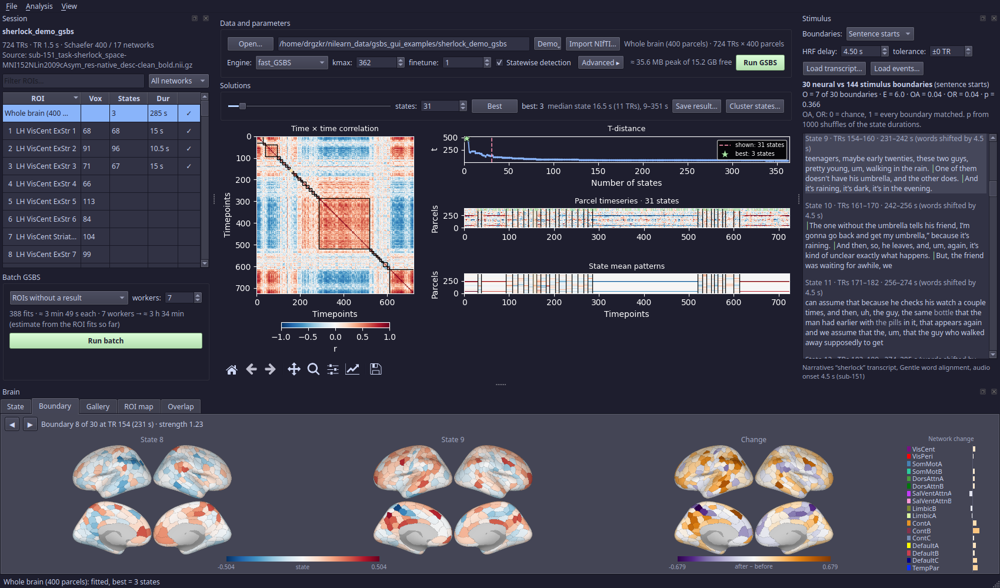

# GSBS GUI

An interactive GUI for running and exploring results of the
[Greedy State Boundary Search (GSBS)](https://github.com/lgeerligs/statesegmentation)
algorithm, which segments fMRI timeseries data into discrete neural states.



---

## Requirements

- Python 3.10+
- PyQt6
- [drgzkr/statesegmentation](https://github.com/drgzkr/statesegmentation), the fork that
  adds `fast_GSBS` (installed by `requirements.txt`; upstream `statesegmentation` lacks it)

---

## Installation

### 1. Clone

```bash
git clone https://github.com/drgzkr/GSBS_GUI.git
cd GSBS_GUI
```

### 2. Create a virtual environment

```bash
python3 -m venv .venv
```

Activate it:

| Platform | Command |
|----------|---------|
| Linux / macOS | `source .venv/bin/activate` |
| Windows PowerShell | `.venv\Scripts\Activate.ps1` |
| Windows cmd.exe | `.venv\Scripts\activate.bat` |

### 3. Install dependencies

```bash
pip install -r requirements.txt
```

---

## Usage

### Main GUI

```bash
python gsbs_gui.py
# or pass a file directly
python gsbs_gui.py data/example_GSBS_object.npy
```

### Try the demo

Click **Demo** and pick either:

- **Fitted demo result**: opens instantly on a pre-fitted result.
- **Demo data only**: fit it yourself and watch the live preview (about 15 s).

The demo is synthetic: 300 TRs × 120 voxels, 26 states, convolved with an HRF and with noise
added, so its true boundaries are known. They are marked ▼ above the voxel timeseries, and the
true number of states is the dotted line on the t-distance curve. GSBS should find 26 states,
with most boundaries within 1 TR of the truth. `tools/make_demo_data.py` regenerates the files.

### Workflow

1. **Open** a `.npy` file: either raw ROI data `(n_timepoints, n_voxels)` or a saved GSBS
   result. The type is detected automatically. A saved result also restores the parameters it
   was fitted with.
2. Set the parameters. kmax defaults to half the number of timepoints. **Statewise detection**
   is on by default, as in `statesegmentation`. `finetune order`, `dmin` and `blocksize` are
   under **Advanced**. The estimated peak memory is shown next to **Run**; it grows with the
   square of the number of timepoints, and you are asked to confirm a run that would exceed
   free memory.
3. **Run GSBS**. The fit runs in a separate process, with a progress bar and time estimate.
   The t-distance curve and boundaries draw live as it runs. **Cancel** stops it immediately.
   `fast_GSBS` is the default engine; `GSBS (reference)` gives identical results, more slowly.
4. Explore the solutions with the slider, the **states** box or a click on the t-distance
   curve. **Best** (or the B key) returns to the highest t-distance.
5. **Save result…** writes the fitted object as a plain `GSBS` object, which loads with or
   without this fork installed.

#### Reading the plots

- The slider steps through every solution the fit produced. With statewise detection, GSBS
  sometimes adds two boundaries in one iteration, so some numbers of states never exist as a
  solution. Those are skipped rather than shown under the wrong count.
- Boundaries are drawn on pixel edges: a state starting at TR *b* has its edge at *b* − 0.5.
- The correlation matrix uses a diverging colour map centred on zero. The timeseries are shown
  per-voxel demeaned, with the raw data and the state means on the same colour scale.

### Whole-brain analysis from a NIfTI

The quickest way to see the whole workflow is **Demo › Ready-made session: "Sherlock" recall,
whole brain + 12 ROIs fitted**. It opens the 18-minute Narratives *Sherlock* scan as a session
with the whole brain and 12 ROIs already fitted, and the transcript attached. ROI 196 is
flagged for having its best solution at kmax. The fits, summary and transcript ship in
`data/demo_sherlock/` (5.7 MB). The voxel data don't: the NIfTI (≈ 138 MB) downloads once
and is imported with the stored settings in a few seconds. The import is checked against
the stored whole-brain fit before the results are added. `tools/make_sherlock_demo.py`
rebuilds the package from a fitted session.

To import a scan yourself, choose **Demo › Online example NIfTI**. Each scan downloads
once, with progress and a Cancel button, then the import dialog opens with the file and TR
filled in.

| Example | Length | Download |
|---|---|---|
| Movie: Pixar *Partly Cloudy*, one adult (nilearn development fMRI; Richardson et al., 2018), fMRIPrep, 4 mm | 168 TRs × 2 s (5.6 min) | ≈ 6 MB |
| Spoken recall of BBC *Sherlock* (Narratives, sub-151) | 724 TRs × 1.5 s (18 min) | ≈ 138 MB |
| *Tunnel Under the World*, F. Pohl, X Minus One broadcast (Narratives, sub-041) | 1040 TRs × 1.5 s (26 min) | ≈ 199 MB |
| *The 21st Year*, C. Lazaridi (Narratives, sub-257) | 2249 TRs × 1.5 s (56 min) | ≈ 430 MB |

**Pixar.** The NIfTI header says TR = 1 without units, so the dialog sets 2 s from the dataset
description. The example's fMRIPrep confounds are included.

**Narratives** (Nastase et al., 2021, *Sci Data* 8:250; CC0). These come from the INDI S3
mirror over plain HTTPS, as the `afni-nosmooth` `desc-clean` images: MNI space,
3 × 3 × 4 mm. Motion, five CSF/white-matter components, a 128 s high-pass and polynomial
trends are already regressed out, so no confounds file is applied again. Each scan has a few
more volumes than the story itself.

Downloads go to `~/nilearn_data`. For comparison, on an 8-core laptop the 18-min scan took
18 s to download, 5 s to import and 224 s for the whole-brain fit.

The import dialog checks the TR in the header. It warns when the header records no time
units. It also catches a value written in milliseconds but labelled as seconds (some Narratives
runs say 1500 s), reads it as 1.5 s, and says so.

**Import NIfTI…** (Ctrl+I) takes a 4D NIfTI in MNI space and creates a *session*:

1. **Import.** The import extracts every Schaefer voxel (100–1000 parcels, 7 or 17
   networks; default 400 / 17), optionally regresses fMRIPrep confounds (motion, white
   matter, CSF), detrends and high-pass filters, then z-scores each voxel and averages
   within parcels. This matches the GSBS scripts (`run_gsbs_sherlock.py`). Detrending is
   on by default: fMRIPrep outputs are not detrended, and drift makes GSBS split a run
   into a few long states (on nilearn's sample scan, 2 states without detrending and 30
   with it). The import runs in the background and can be cancelled.
2. **Whole-brain fit.** GSBS on the parcel timeseries runs automatically when the import
   finishes, unless you untick that option.
3. **ROIs.** The **Session** panel lists every parcel. Selecting one loads its voxels ×
   time data into the main view to fit on its own. You can also click an ROI on the brain
   map (ROI map tab), or double-click a parcel on any state map. Every fit is saved into
   the session automatically.
4. **Batch.** Fit every ROI, the ones without a result, or a selection, using several
   worker processes. Before starting, you get a time estimate (from the whole-brain fit,
   then from finished ROIs) and a suggested number of workers (CPU cores − 1, fewer if
   memory is short). While it runs, it shows a progress bar, the time left and what each
   worker is doing. **Pause** lets running fits finish and starts nothing new.
   **Cancel** stops immediately. Finished results are kept, so a cancelled batch can be
   resumed.

The **Brain** panel appears when the data are Schaefer parcels. That covers a session's
whole-brain data, a result saved from one, or any `.npy` whose column count matches a
Schaefer atlas once you choose it from the **Columns** menu. Its tabs:

- **State**: the selected state's mean pattern on the inflated fsaverage surface, with
  mean values per Yeo network. Click a timepoint in the timeseries or correlation matrix
  to select its state.
- **Boundary**: the states before and after a boundary and the change between them, with
  the boundary's strength. ◀ ▶ step through the boundaries.
- **Gallery**: every state of the current solution, on one colour scale. Click a tile to
  select that state.
- **ROI map**: one number per ROI from the session's fits: number of states, median
  state duration, voxel count or fit time. Click an ROI to open it.

Parcel values are painted through Schaefer's own fsaverage annotation files (CBIG
repository), not by projecting the volumetric atlas onto the surface. That projection
assigns the wrong parcel, or none, to about 28% of cortical fsaverage5 vertices. Each
surface view is rasterised once, so drawing a map is a per-pixel lookup taking tens of
milliseconds. Drawing four views with matplotlib in 3D takes 10 s to over two minutes.
First use downloads the annotation (≈ 2.6 MB) and the fsaverage mesh (≈ 34 MB), and
draws the views once (≈ 6 s, in the background). The views are cached in
`~/.cache/gsbs_gui`, the downloads in `~/nilearn_data`.

### Stimulus text and boundary overlap

The **Stimulus** panel (right) shows the story transcript laid out as the states of the
solution shown. Every word is placed at the TR containing its onset plus an HRF delay (default
4.5 s). Selecting a state anywhere highlights its words; clicking a state's heading selects it
in the plots and the brain panel.

The Narratives examples bring their transcripts automatically. The words are timed with Gentle
forced alignment, and the punctuation is recovered from each word's position in the
transcript. They are placed on the scan using the audio onset from the participant's
`events.tsv`. For your own data, **Load transcript…** reads a TSV/CSV with `word` and `onset`
columns (seconds from the first volume); **Load events…** reads onsets from a BIDS
`events.tsv` or one number per line. Both are saved into the session.

Stimulus boundaries can be **sentence starts**, **speech pauses** (the first word after at
least *n* s of silence), or **loaded events**, all shifted by the same HRF delay. They are
drawn as green ticks on the timeseries. The panel reports their overlap with the boundaries of
the solution shown.

**Analysis › Boundary overlap…** (Ctrl+B) compares any two boundary sets: the solution shown,
the whole brain's best solution, any fitted ROI's best solution, or the stimulus. It shows
both sets as a raster with the matches highlighted, and the null distribution. **Every fitted
ROI against the reference** computes the overlap for all ROIs at once, lists them with
Benjamini–Hochberg q-values across ROIs, and maps OR on the ROI map.

**Overlap map** (the **Overlap** tab of the brain panel). Every fitted ROI's best solution is
compared with a reference, and the result is painted on the surface.

- **Reference:** the stimulus boundaries as set in the stimulus panel, or the whole brain's
  best solution.
- **HRF delay**, for a stimulus reference: either the stimulus panel's delay, or a scan over a
  grid (0–9 s in TR steps), in which each ROI gets its best delay.
- **Correcting for the delay search.** Picking the best of several delays inflates OR, so
  that ROI's p-value compares its best OR with the best OR over all delays in each shuffle (a
  max-statistic null). On unrelated segmentations this keeps false positives near 5%, against
  about 23% for the uncorrected p at the best delay.
- **Show:** OR (all ROIs); OR where p < .05 with FDR across ROIs; OR where p < .05
  uncorrected; or the best HRF delay per ROI, for all ROIs or only those with q < .05.
- **Network means** next to the map: the mean of the shown quantity (OR or best delay) over
  all fitted ROIs in each Yeo network, unthresholded, because averaging only the significant
  ROIs would inflate every network. Each row ends with significant/fitted counts (q < .05),
  e.g. `2/9`.
- **Exclusions:** ROIs whose best solution sits at kmax are left out.
- **Interaction:** hover an ROI for its OR, p, q and best delay; click it to open the ROI.

The measures follow Geerligs et al. (2022) and `neuro_tools.compute_boundary_overlap`:

- O is the number of shared boundary TRs, and E = n_ref · n_test / T is the chance level.
- **OA** = (O − E) / (n_test − E); **OR** = (O − E) / (min(n_ref, n_test) − E). For both,
  0 means chance and 1 means every boundary is matched.
- **p** comes from shuffling the test segmentation's state durations, as in the notebooks'
  `overlap_permutation_test_optimized`. Here every state is shuffled, including the last, and
  p = (shuffles ≥ O + 1) / (n + 1).
- With a ± tolerance, each boundary can be matched only once, and E comes from the shuffles.

### State clusters

**Analysis › State clusters…** (Ctrl+K), or **Cluster states…** next to Save result, groups
the states of the segmentation shown in the main window by how similar their patterns are.
The window follows the main window: moving to another solution reclusters it with the same
settings.

- **Methods** (each on state patterns z-scored across columns):
  - hierarchical clustering (average linkage, correlation distance);
  - DBSCAN with cosine distance, as in the Global States / HippoDirector notebooks;
  - k-means.
- **Scan** tries a range of settings and uses the best silhouette. The silhouette is computed
  with the clustering's own distance, and DBSCAN noise states count as 0.
- **Clusters tab:** each cluster's mean pattern, on the brain with network means for Schaefer
  parcel data, or as a voxel strip otherwise, with its number of states and share of the time.
- **Timeline tab:** the cluster of every state over time; the transition matrix P(next |
  current) between different clusters, with counts written in; and each cluster's share of
  the time.
- **Similarity tab:** the state × state correlation matrix sorted by cluster, and the scan
  curve.
- **Export:** a CSV with one row per state (TRs, cluster) and an `.npz` with the cluster
  patterns, labels and transition counts.

#### Session folder

```
<name>_gsbs/
    session.json          source file, atlas, TR, preprocessing, voxels per parcel
    parcels.npy           (timepoints × parcels) whole-brain timeseries
    voxels.npy            (voxels × timepoints) float32, sorted by parcel
    voxel_labels.npy      parcel of each voxel row
    voxel_ijk.npy         voxel indices in the source image
    results/
        whole_brain.npy   fitted GSBS objects (plain GSBS pickles with a
        roi_0001.npy      gsbs_gui_meta attribute describing the data)
        summary.json      states, median duration and fit time per target
```

The session takes about as much disk space as the source NIfTI's brain voxels in
float32. Reopen a session with **File › Open session folder…**.

### Input data format

```python
import numpy as np
# shape: (timepoints, channels/voxels)
data = np.load("my_roi_data.npy")   # must be 2D
```

---

## Stimulus Boundary Viewer

`gsbs_stimuli_viewer.py` is a companion popup for inspecting stimulus images
at each state boundary. It expects a folder of images — one image per timepoint,
sorted by filename.

```bash
# standalone — opens folder picker, then shows demo boundaries
python gsbs_stimuli_viewer.py /path/to/stimuli_folder

# with a GSBS object (uses best k automatically)
python gsbs_stimuli_viewer.py /path/to/stimuli_folder data/example_GSBS_object.npy

# with explicit k
python gsbs_stimuli_viewer.py /path/to/stimuli_folder data/example_GSBS_object.npy 5
```

The viewer shows a scrollable strip of thumbnails centred on each boundary frame
(highlighted in red), with a slider to navigate between boundaries and a
**Context frames** spinbox to control how many frames before/after to display.

It can also be imported and embedded:

```python
from gsbs_stimuli_viewer import StimuliViewer, load_stim_paths

stim_paths = load_stim_paths("/path/to/stimuli_folder")
boundaries = [47, 112, 203]   # timepoint indices
dlg = StimuliViewer(boundaries, stim_paths, parent=self)
dlg.exec()
```

---

## Development

### Install dev dependencies

```bash
pip install -r requirements-dev.txt
```

### Run tests

```bash
pytest tests/
```

Tests are headless (Qt's `offscreen` platform), so no display server or `xvfb` is needed.
They include real fits in child processes and a synthetic NIfTI import, so the suite
takes about 25 s. `test_brain.py` needs the fsaverage mesh and Schaefer annotation (cached
after first use) and is skipped when they cannot be downloaded.

#### With coverage report

```bash
pytest tests/ --cov=gsbs_gui --cov=gsbs_core --cov-report=term-missing
```

### Project layout

```
gsbs_gui.py                  main PyQt6 application (GridSpec layout)
gsbs_core.py                 Qt-free logic: reading results, I/O, memory, child-process fit
gsbs_nifti.py                NIfTI import (child process) and the Session folder
gsbs_batch.py                multi-process batch fits with pause / cancel / ETA
gsbs_atlas.py                Schaefer names, networks, fsaverage annotations
gsbs_surface.py              rasterised fsaverage views: fast parcel maps and picking
gsbs_brain_panel.py          Brain panel (State / Boundary / Gallery / ROI map)
gsbs_session_panel.py        Session panel (ROI table, batch) and the import dialog
gsbs_clusters.py             clustering the states of one segmentation, transitions
gsbs_cluster_window.py       State clusters window
gsbs_overlap.py              boundary overlap (O, E, OA, OR, permutation p)
gsbs_stimulus.py             transcripts on the scan, stimulus boundaries, event files
gsbs_stimulus_panel.py       Stimulus panel (transcript by state, overlap readout)
gsbs_overlap_window.py       Boundary overlap window (pairs, all ROIs, ROI map)
gsbs_stimuli_viewer.py       standalone stimulus boundary viewer popup
requirements.txt             runtime dependencies
requirements-dev.txt         development / test dependencies
assets/
    screenshot.png           GUI screenshot
tools/
    make_demo_data.py        regenerates the demo files (deterministic)
    make_sherlock_demo.py    packages a fitted session as the ready-made demo
data/
    demo_roi_data.npy              synthetic demo data (300×120), known boundaries
    demo_true_bounds.npy           the demo's true boundaries, in BOLD time
    demo_GSBS_object.npy           pre-fitted demo result
    demo_sherlock/                 ready-made session: fits, summary, transcript, import settings
    example_roi_data.npy           synthetic 2D fMRI-like array (438×401)
    example_GSBS_object.npy        pre-fitted GSBS result
legacy/
    gsbs_gui_splitter.py     earlier Qt splitter-based layout (archived)
    gsbs_gui_tkinter.py      classic tkinter/ttk version (archived)
    gsbs_gui_ttkbootstrap.py ttkbootstrap dark-theme version (archived; needs ttkbootstrap)
tests/
    conftest.py              offscreen Qt setup
    test_core.py             solutions, state means, load/save, memory, fit runner
    test_gui.py              demo, slider/snapping, live fit, cancel, session flow
    test_session.py          NIfTI import, sessions, batch runs (synthetic 4D image)
    test_brain.py            Schaefer annotations, surface rendering and picking
    test_clusters.py         clustering recovery, silhouette noise scoring, transitions
    test_overlap.py          overlap formulas, tolerance, shuffles, transcripts, event files
```

---

## Known limitations / TODO

- Stimuli viewer not yet wired into the main GUI toolbar (run standalone for now).
- macOS figure DPI scaling not specifically handled.
